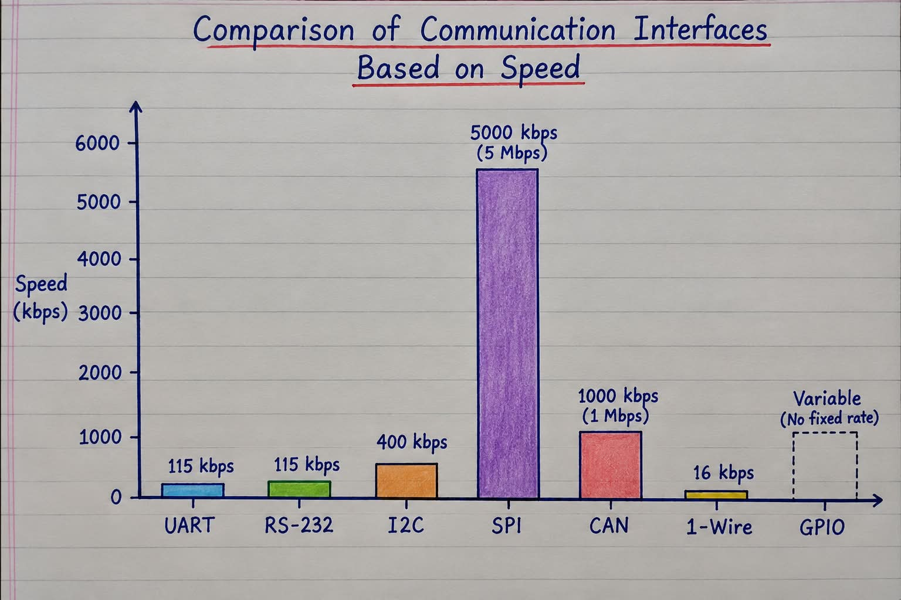
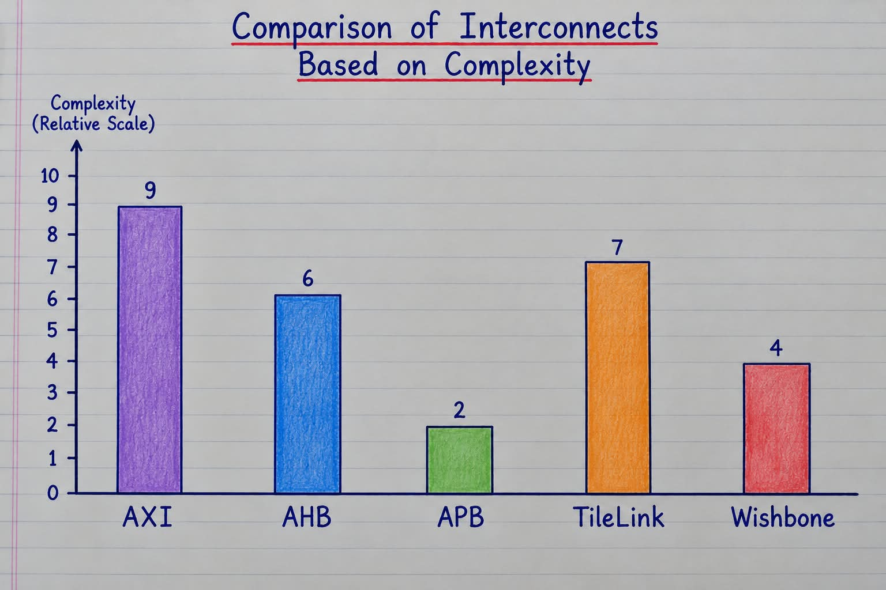

# Interface Comparison: Serial and Peripheral Protocols

| Factor | UART | RS-232 | I2C | SPI | CAN | 1-Wire | GPIO |
|---|---|---|---|---|---|---|---|
| Main Purpose | Serial communication | Electrical standard for serial communication | Sensor and peripheral communication | High-speed peripheral communication | Multi-node control network | Simple, low-speed device communication | Digital input/output control |
| Typical Speed | 9.6–115.2 kbps common | 9.6–115.2 kbps common | 100 kbps, 400 kbps common | Often MHz range | Classical CAN: up to 1 Mbps | Around 16 kbps in standard mode | No fixed data rate; depends on implementation |
| Signals | TX, RX, GND | TX, RX, GND as required | SDA, SCL | SCLK, MOSI, MISO, CS | CAN_H, CAN_L | One data wire + GND | One or more configurable digital pins |
| Multiple Devices | Extra UARTs or multiplexing needed | Usually point-to-point | Yes, shared bus | Yes, usually separate CS signals | Yes, shared bus | Yes, for supported devices | Multiple devices can connect through separate pins or suitable circuitry |
| Distance | Depends on implementation | Can support longer serial links | Usually short PCB-level links | Usually short PCB-level links | Suitable for vehicle and industrial networks | Usually short distances | Usually short, board-level connections |
| Complexity | Low | Low to medium | Low to medium | Low to medium | Medium to high | Low | Low |
| Example | FPGA console | Legacy serial equipment | Temperature sensor | Flash memory, display | Automotive ECUs | Temperature sensor, ID chip | LED, push button, reset signal |
| Main Advantage | Simple and easy to debug | Standardised electrical interface | Fewer wires for multiple devices | High speed and full-duplex capability | Multi-node communication and error handling | Minimal wiring | Simple control without a complex communication protocol |
| Main Limitation | No built-in addressing | Usually point-to-point | Lower speed than many SPI setups | More wires and chip-select management | Requires CAN controller and suitable transceivers | Low bandwidth and device restrictions | No built-in addressing, packet framing, or communication protocol |

# Interconnect Protocols Comparison

## 1. Basic Comparison

| Factor | Wishbone | TileLink | AMBA AXI | AMBA AHB | AMBA APB |
|---|---|---|---|---|---|
| Full Name | Wishbone Bus | TileLink Interconnect Protocol | Advanced eXtensible Interface | Advanced High-performance Bus | Advanced Peripheral Bus |
| Developed By | OpenCores community | SiFive / RISC-V ecosystem | Arm | Arm | Arm |
| Main Purpose | Connect reusable hardware IP | Connect components in a SoC | High-performance data transfer | Embedded system bus communication | Simple peripheral access |
| Common Use | FPGA designs and soft CPUs | RISC-V SoCs | Memory, DMA, accelerators | CPU, SRAM, system interconnect | UART, GPIO, timers |
| Typical Complexity | Low to high, variant-dependent | Variant-dependent | High | Medium | Low |
| Performance Focus | Flexible IP integration | SoC transaction handling | High throughput and concurrency | Pipelined transfers | Low-bandwidth control |
| Typical Traffic | Register and memory transactions | SoC memory and device transactions | High-bandwidth memory/data traffic | Embedded system traffic | Control and status registers |

## 2. Transaction and Transfer Features

| Feature | Wishbone | TileLink | AMBA AXI | AMBA AHB | AMBA APB |
|---|---|---|---|---|---|
| Basic Transfer | Request and acknowledge, depending on variant | Request and response channels | Independent read/write channels | Address and data phases | Setup and access phases |
| Read and Write | Supported | Supported | Separate read and write channels | Read/write through shared bus signals | Read/write through shared bus signals |
| Pipelining | Supported by suitable modes | Variant-dependent | Supported | Supported | Not a high-performance pipelined data bus |
| Burst Transfers | Depends on interface/implementation | Variant-dependent | Supported | Supported | Typically not supported |
| Multiple Outstanding Transactions | Implementation-dependent | Variant-dependent | Supported | More limited in typical implementations | Generally simple, limited transaction model |
| Back-Pressure | Depends on handshake variant | Supported by suitable channels/variants | READY/VALID handshakes | Uses transfer and wait-state controls | PREADY can extend access |
| Error Response | Depends on implementation and signals | Depends on variant | Response signals support error reporting | Response signals support error reporting | PSLVERR can indicate an error |
| Cache Coherence | Not a defining base feature | TileLink-C supports coherence | Not inherently provided by AXI alone | Not inherently provided by AHB alone | Not provided |

## 4. Signals and Protocol Behaviour

| Factor | Wishbone | TileLink | AMBA AXI | AMBA AHB | AMBA APB |
|---|---|---|---|---|---|
| Common Signals | CLK, RST, ADR, DAT, CYC, STB, ACK (variant-dependent) | A-channel request and D-channel response; exact signals depend on variant | AW, W, B, AR, R channels | HADDR, HTRANS, HWRITE, HWDATA, HRDATA, HREADY, HRESP | PADDR, PSEL, PENABLE, PWRITE, PWDATA, PRDATA, PREADY |
| Handshake Style | Commonly request/acknowledge | Channel handshakes | VALID/READY | Transfer control and ready/wait signalling | Setup/access with PREADY |
| Separate Read/Write Channels | Not generally required by the classic interface | Variant-dependent channel structure | Yes | No, shared address/control bus | No, shared address/control signals |
| Addressing | Address signals defined by implementation | Address carried in transactions | Address channels | Address/control phase | Peripheral register address |
| Wait States | Supported through acknowledgement timing | Depends on channel response | Through READY/VALID flow control | HREADY can extend transfers | PREADY can extend access |

## 5. Which Protocol Should You Choose?

| Requirement | Suitable Choice | Reason |
|---|---|---|
| Simple open-source FPGA IP connection | Wishbone | Flexible and widely used in open hardware |
| RISC-V SoC designed around TileLink | TileLink | Designed for SoC transactions and supported variants |
| High-throughput memory interface | AXI | Bursts, separate channels, and outstanding transactions |
| Embedded processor and SRAM interconnect | AHB | Pipelined transfers and embedded-system focus |
| GPIO, UART, and timer registers | APB | Simple peripheral register access |
| High-performance DMA | AXI or another suitable high-performance interconnect | Supports high-throughput data movement |
| Simple custom core bus | Wishbone or a custom interface | Can be easier to implement for a small design |

## 6. Important Concepts

| Term | Meaning | Example |
|---|---|---|
| Bandwidth | Amount of data transferred per second | A 32-bit bus at 100 MHz has 400 MB/s theoretical bandwidth at one beat per cycle |
| Latency | Time taken for a transaction to receive a response | Waiting for a memory read |
| Pipelining | Different transfer stages can overlap | AHB address phase overlaps with an earlier transfer's data phase |
| Burst | Multiple data beats associated with one transaction | AXI burst to memory |
| Outstanding Transaction | A request has been issued but its response has not yet completed | AXI issues multiple reads before earlier responses return |
| Arbitration | Selects which requester gets access to a shared resource | CPU and DMA both request memory access |
| Back-Pressure | Receiver temporarily prevents more transfers | READY is low while the receiver cannot accept data |
| Bridge | Connects two interfaces or protocols | AXI-to-APB bridge |
| Address Decoder | Selects a target based on the transaction address | A particular address range selects UART registers |
| Cache Coherence | Keeps cached copies of shared data consistent | TileLink-C coherence-capable system |

## 7. Final Summary

- **Wishbone:** Flexible open-hardware bus; features depend on the selected interface variant.
- **TileLink:** SoC transaction protocol with variants for different capabilities; TileLink-C supports coherence.
- **AXI:** High-performance interconnect with separate read/write channels, bursts, and multiple outstanding transactions.
- **AHB:** Pipelined embedded-system bus.
- **APB:** Simple, low-bandwidth peripheral register interface.

**Important:** These protocols do not have one universal speed limit. Actual performance depends on bus width, clock frequency, implementation, target response, arbitration, and wait states.

