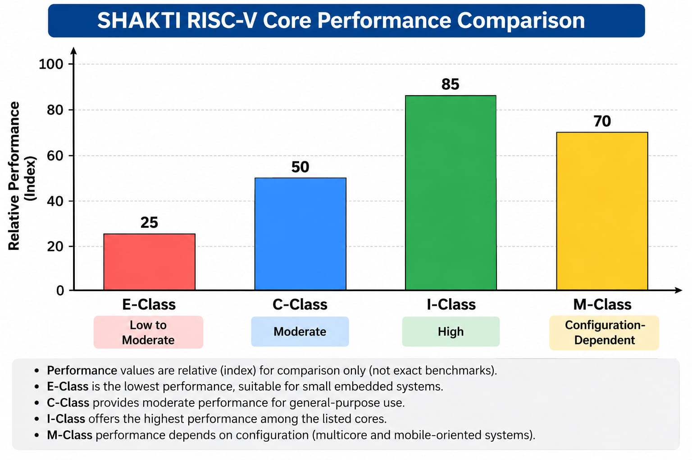

# Shakti
SHAKTI is an open-source processor development initiative led by the RISE group at IIT Madras. It is based on the RISC-V instruction set architecture (ISA) and includes processor cores, SoC components, interconnect fabrics, verification tools and software support.

The important thing to understand is that SHAKTI is a family of processor designs, not a single core. Different variants target different requirements, from small embedded controllers to high-performance computing.

# SHAKTI RISC-V Core Comparison

| Core / Variant | Main Purpose | Performance Level | Interconnect Protocols / Fabric | Typical Applications |
|---|---|---|---|---|
| E-Class | Small embedded systems | Low to Moderate | AHB-Lite; integration-dependent interfaces | IoT, sensors, embedded controllers |
| C-Class | General-purpose controller | Moderate | AXI4, AXI4-Lite, TileLink-U (configuration-dependent) | Embedded Linux, control systems |
| I-Class | High-performance processing | High | TileLink-based cache connections; AXI4 for system integration where supported | Compute-intensive applications |
| M-Class | Multicore and mobile-oriented systems | Configuration-dependent | TileLink-based coherent connections; AXI/AHB bridges where required | Multicore computing, mobile-oriented systems |

